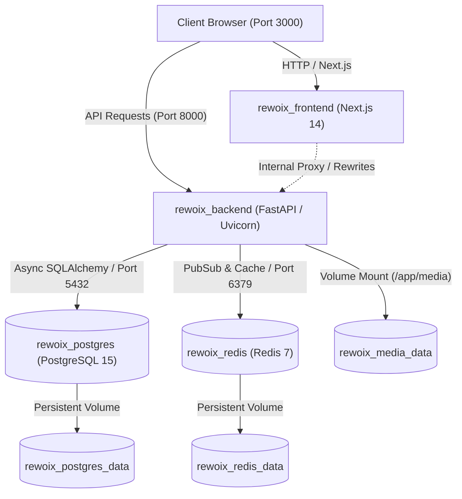

# 🐳 REWOIX Docker Deployment & Operations Guide

Welcome to the **REWOIX** Containerized Environment documentation. This guide provides comprehensive, step-by-step instructions to run, develop, manage, and scale the entire REWOIX platform using Docker and Docker Compose.

---

## 📑 Table of Contents

1. [Architecture & Container Topology](#-architecture--container-topology)
2. [Prerequisites](#-prerequisites)
3. [Quick Start (Single-Command Launch)](#-quick-start-single-command-launch)
4. [Service Ports & Endpoints](#-service-ports--endpoints)
5. [Environment Configuration (`.env.docker`)](#-environment-configuration)
6. [Automated Migrations & Database Seeding](#-automated-migrations--database-seeding)
7. [Development Mode (Live Hot-Reload)](#-development-mode-live-hot-reload)
8. [Common Operational Commands](#-common-operational-commands)
9. [Pre-Seeded Demo Credentials](#-pre-seeded-demo-credentials)
10. [Cloud Production Deployment](#-cloud-production-deployment)
11. [Troubleshooting & FAQs](#-troubleshooting--faqs)

---

## 📐 Architecture & Container Topology

The REWOIX Docker ecosystem is orchestrated as an isolated, multi-tier micro-network (`rewoix_network`):



| Service | Container Name | Base Image | Role |
| :--- | :--- | :--- | :--- |
| **`frontend`** | `rewoix_frontend` | `node:18-alpine` | Next.js 14 App Router, Tailwind CSS, Dark/Light theme, Simulation Sandbox UI |
| **`backend`** | `rewoix_backend` | `python:3.11-slim` | FastAPI ASGI REST API, Alembic DB Migrations, Razorpay Checkout, RBAC & Auth |
| **`postgres`** | `rewoix_postgres` | `postgres:15-alpine` | High-performance relational database with ACID ledger transactions |
| **`redis`** | `rewoix_redis` | `redis:7-alpine` | Fast in-memory cache, rate limiting, and async worker broker |

---

## 🛠 Prerequisites

Before launching the stack, ensure your system has:
- **Docker Engine**: `v24.0.0` or later (or [Docker Desktop](https://www.docker.com/products/docker-desktop/)).
- **Docker Compose**: `v2.20.0` or later (`docker compose version`).
- **RAM**: Minimum 4 GB allocated to Docker Desktop (8 GB recommended for builds).
- **Available Ports**: Ensure ports `3000`, `8000`, `5432`, and `6379` are not bound by local background services.

---

## 🚀 Quick Start (Single-Command Launch)

### 1. Clone the repository
```bash
git clone https://github.com/Tejaso7/REWOIX.git
cd REWOIX
```

### 2. Prepare Environment Configuration
Copy the supplied Docker template to your active `.env`:
```bash
cp .env.docker.example .env
```
*(On Windows PowerShell, use: `Copy-Item .env.docker.example .env`)*

### 3. Build & Boot the Production Stack
Run a single command to build images, initialize volumes, apply migrations, seed the database, and start all containers in detached mode:
```bash
docker compose up --build -d
```

### 4. Verify Service Health
Check the container status:
```bash
docker compose ps
```
You should see all 4 services running with `healthy` status:
```text
NAME                IMAGE                  COMMAND                  SERVICE      STATUS
rewoix_postgres     postgres:15-alpine     "docker-entrypoint.s…"   postgres     Up (healthy)
rewoix_redis        redis:7-alpine         "docker-entrypoint.s…"   redis        Up (healthy)
rewoix_backend      rewoix-backend         "/app/docker-entrypo…"   backend      Up (healthy)
rewoix_frontend     rewoix-frontend        "docker-entrypoint.s…"   frontend     Up (healthy)
```

---

## 🌐 Service Ports & Endpoints

| Resource | URL | Description |
| :--- | :--- | :--- |
| **Web Application** | [http://localhost:3000](http://localhost:3000) | Landing page, Simulation catalog, Student workspace player |
| **Interactive API Docs** | [http://localhost:8000/docs](http://localhost:8000/docs) | Swagger UI for testing FastAPI endpoints |
| **ReDoc API Specs** | [http://localhost:8000/redoc](http://localhost:8000/redoc) | Alternative OpenAPI reference documentation |
| **Backend Healthcheck** | [http://localhost:8000/health](http://localhost:8000/health) | Uptime JSON payload (`healthy`, `version 1.0.0`) |
| **PostgreSQL Database** | `localhost:5432` | DB: `rewoix_db`, User: `postgres`, Pass: `postgrespassword` |
| **Redis Cache** | `localhost:6379` | In-memory key-value cache and job queues |

---

## ⚙ Environment Configuration

The file `.env.docker.example` defines all customizable variables:

| Variable | Default Value | Description |
| :--- | :--- | :--- |
| `APP_ENV` | `production` | FastAPI application mode (`production` or `development`) |
| `SECRET_KEY` | *(Generated random)* | JWT HMAC-SHA256 signature token secret key |
| `FRONTEND_PORT` | `3000` | Host port mapped to Next.js |
| `BACKEND_PORT` | `8000` | Host port mapped to FastAPI |
| `POSTGRES_PORT` | `5432` | Host port mapped to PostgreSQL |
| `REDIS_PORT` | `6379` | Host port mapped to Redis |
| `POSTGRES_USER` | `postgres` | Superuser for database container |
| `POSTGRES_PASSWORD` | `postgrespassword` | Secure password for database container |
| `POSTGRES_DB` | `rewoix_db` | Primary database name |
| `NEXT_PUBLIC_API_URL` | `http://localhost:8000/api/v1` | Public API endpoint contacted by client web browser |
| `RAZORPAY_KEY_ID` | `rzp_test_placeholder` | Razorpay Merchant Key ID for course payments |
| `RAZORPAY_KEY_SECRET` | `rzp_test_secret_placeholder` | Razorpay API Secret |
| `STORAGE_PROVIDER` | `local` | Upload storage provider (`local`, `azure`, `s3`) |

---

## 🔄 Automated Migrations & Database Seeding

When the backend container boots up, [`backend/docker-entrypoint.sh`](file:///c:/Users/Neha/Documents/antigravity/eager-lavoisier/backend/docker-entrypoint.sh) automatically runs:

1. **PostgreSQL Connectivity Probe**: Polls `postgres:5432` until the database is ready to accept queries.
2. **Alembic Schema Migrations**: Runs `alembic upgrade head` to generate all 12 SQL tables.
3. **Idempotent User Seeding** (`seed.py`): Checks whether default Admin, Teacher, and Student accounts exist; if absent, creates them with hashed credentials.
4. **Idempotent Course Seeding** (`scripts/seed_courses.py`): Populates the catalog with 10+ real-world simulation courses (Fintech, E-commerce, AI/ML, Cloud Data).

---

## 💻 Development Mode (Live Hot-Reload)

To edit code locally and see changes reflected in containers immediately without rebuilding images, use the development compose configuration:

```bash
docker compose -f docker-compose.dev.yml up
```

- **Backend Hot-Reload**: Mounts `./backend` to `/app` with `--reload` active on Uvicorn.
- **Frontend Fast Refresh**: Mounts `./frontend` to `/app` with Next.js development server.

---

## 📋 Common Operational Commands

### View Logs in Real-Time
```bash
# View aggregated logs for all services
docker compose logs -f

# View backend logs only
docker compose logs -f backend

# View frontend logs only
docker compose logs -f frontend
```

### Run Tests Inside the Container
Run the automated pytest test suite inside the isolated backend environment:
```bash
docker compose exec backend python -m pytest tests
```

### Access Container Shell
```bash
# Open interactive shell in backend
docker compose exec backend bash

# Open interactive psql shell in database
docker compose exec postgres psql -U postgres -d rewoix_db
```

### Database Backup & Restore
```bash
# Export full SQL dump
docker compose exec postgres pg_dump -U postgres rewoix_db > rewoix_backup.sql

# Restore SQL dump
cat rewoix_backup.sql | docker compose exec -T postgres psql -U postgres -d rewoix_db
```

### Stop & Clean Up
```bash
# Stop all containers
docker compose stop

# Stop and remove containers and network
docker compose down

# Stop, remove containers, and purge database volumes (Reset everything)
docker compose down -v
```

---

## 🔐 Pre-Seeded Demo Credentials

The Docker stack automatically provisions standard test accounts:

| Role | Email | Password | Pre-Configured Capabilities |
| :--- | :--- | :--- | :--- |
| **👑 Admin** | `admin@example.com` | `admin123` | Full dashboard, platform revenue ledger, custom teacher commission adjuster, course approvals, user directory |
| **👨‍🏫 Teacher** | `teacher@example.com` | `teacher123` | Completed onboarding (Google Tech Lead, ₹35L CTC, Axis Bank), course creator, earnings tracker |
| **🎓 Learner** | `student@example.com` | `student123` | Active track enrollments, SQL workspace sandbox, downloadable cryptographic certificates |

---

## ☁ Cloud Production Deployment

### 1. Reverse Proxy & SSL (Recommended)
In front of the Docker stack, run Nginx, Traefik, or Caddy with Let's Encrypt for automatic HTTPS:
```text
https://rewoix.com        --> proxy_pass http://frontend:3000
https://api.rewoix.com    --> proxy_pass http://backend:8000
```

### 2. Managed Cloud Container Options
- **AWS ECS / Fargate**: Deploy `Dockerfile.backend` and `Dockerfile.frontend` as separate task definitions behind an Application Load Balancer (ALB), with Amazon Aurora PostgreSQL and ElastiCache Redis.
- **Google Cloud Run**: Build images with Google Cloud Build and deploy serverless containers.
- **DigitalOcean App Platform**: Point to the GitHub repository, deploy backend service and frontend static/Node service.
- **Single VPS (Ubuntu / Debian on Hetzner or AWS EC2)**:
  1. Install Docker & Docker Compose.
  2. Clone repo & set `.env` with strong passwords.
  3. Run `docker compose up -d`.
  4. Attach Caddy or Nginx reverse proxy with SSL.

---

## ❓ Troubleshooting & FAQs

### Q: Port 5432 or 8000 is already in use
**Solution**: Change the host ports in `.env`:
```env
FRONTEND_PORT=3001
BACKEND_PORT=8001
POSTGRES_PORT=5433
```
Then run `docker compose up -d`.

### Q: Next.js frontend cannot connect to backend in browser
**Solution**: `NEXT_PUBLIC_API_URL` is used by your browser (on the host machine), so it must point to `http://localhost:8000/api/v1` (or your public domain), not `http://backend:8000/api/v1`. The internal name `http://backend:8000` is only accessible inside the Docker bridge network.

### Q: Database migrations fail during first launch
**Solution**: Run manual migration inside the container:
```bash
docker compose exec backend alembic upgrade head
docker compose exec backend python seed.py
```

### Q: Docker build fails with out-of-memory error
**Solution**: In Docker Desktop Settings → Resources → Advanced, increase allocated RAM to at least 4 GB or 8 GB, then re-run:
```bash
docker compose build --no-cache
```

---

*Authored for the REWOIX Production Platform. All rights reserved.*
