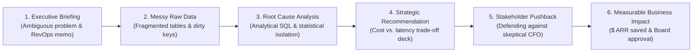

# REWOIX: Executive Overview & Business Strategy

**Platform Brand:** REWOIX (*Real-World Industry Experience*)  
**Audience:** Chief Executive Officer (CEO), Chief Technology Officer (CTO), Board of Directors, and Strategic Investors  
**Version:** 1.0.0 Production  
**Core Thesis:** *"Stop learning projects. Start experiencing work."*

---

## 1. Executive Summary

**REWOIX** is an enterprise-grade **Corporate Experience Simulator** designed to bridge the severe employability chasm between academic tutorials and high-stakes workplace reality.

While traditional EdTech platforms (Coursera, Udemy, bootcamps) teach theoretical syntax using pristine, artificial datasets (e.g., Titanic Kaggle CSVs, cleaned Iris datasets), modern tech companies operate in chaotic environments with:
- Fragmented multi-table relational schemas with orphan keys and dirty timestamps.
- Conflicting stakeholder mandates (e.g., CFO demanding churn reduction while Head of Product resists feature rollbacks).
- Business trade-offs where statistical significance must translate directly to dollar ROI.

REWOIX equips learners (students, career switchers, and junior analysts) to experience real workplace pressure through interactive simulation tracks built and mentored directly by **working professionals** at leading tech corporations.

---

## 2. Market Problem & Positioning

### The "Toy Tutorial" Crisis in Hiring
- **91% of hiring managers** report that entry-level portfolios are indistinguishable clones of tutorial projects.
- Junior analysts fail technical and behavioral interviews because they cannot explain **how** their models impact balance sheets or withstand executive pushback.
- Working professionals who want to mentor or monetize their expertise lack an enterprise marketplace that automates commission splits, banking payouts, and verifiable student certification.

### Positioning Matrix

| Dimension | Generic MOOCs (Coursera, Udemy) | Coding Bootcamps | REWOIX Simulator |
| :--- | :--- | :--- | :--- |
| **Learning Mode** | Passive 50-hour video playback | Cohort lectures with rigid pacing | **Active 6-Stage Corporate Simulation Loop** |
| **Data Quality** | Pre-cleaned 1-table CSVs | Sanitized sample databases | **Dirty production schemas with orphan keys** |
| **Stakeholder Pressure**| Non-existent | Synthetic peer reviews | **Simulated CFO/VP RevOps pushback scenarios** |
| **Instructors** | Full-time academic lecturers | Generalist bootcamp coaches | **Vetted Working Professionals (Staff/Lead Engineers)** |
| **Business Alignment** | Accuracy scores (F1, MSE) | Project submission checklist | **Bottom-line Dollar Impact ($ ARR churn, GMV lift)** |
| **Proof of Skill** | PDF attendance certificates | Portfolio GitHub links | **Cryptographically Verifiable Credential & Artifacts** |

---

## 3. The 6-Stage Corporate Simulation Loop

REWOIX replaces passive video watching with an authentic workplace operating cycle:

1. **Executive Briefing:** Urgent corporate scenario (e.g., 18.4% ARR churn drop at NexusPay Global).
2. **Messy Raw Data:** Ingesting multi-partition event streams with latency anomalies and failed dunnings.
3. **Root Cause Analysis:** Writing high-performance analytical queries to isolate exact business triggers.
4. **Strategic Recommendation:** Formulating actionable mitigation trade-offs (e.g., SEPA fallback vs. card updater).
5. **Stakeholder Pushback:** Responding to executive scrutiny and counter-arguments.
6. **Measurable Business Impact:** Quantified revenue recovery ($1.28M saved) and board deliverable generation.

---

## 4. Business Model & Unit Economics

REWOIX operates a high-margin two-sided corporate simulation marketplace:

### Revenue Streams
1. **Direct-to-Learner (B2C / Prosumer):**
   - Individual simulation track sales: **₹2,999 – ₹7,999 ($49 – $99 USD)** per course.
   - Lifetime access to production dataset simulations, mentor Q&A, and verifiable certification.
2. **Platform Commission Split (Dynamic Engine):**
   - Default revenue split: **30% Platform Fee / 70% Instructor Payout**.
   - Admin-configurable per instructor: High-performing staff mentors can receive custom splits (e.g., 80%–85%) directly managed via the Admin Commission Console.
3. **Enterprise & University B2B Licensing (Phase 2):**
   - Bulk institutional seat licenses for university computer science & business analytics departments.
   - Corporate hiring benchmark simulations for tech recruiting teams.

### Projected Unit Economics (Per 1,000 Learners)
- **Average Order Value (AOV):** ₹4,999 (~$60 USD)
- **Gross Merchandise Value (GMV):** ₹4,999,000 (~$60,000 USD)
- **Platform Net Revenue (30%):** ₹1,499,700 (~$18,000 USD)
- **Teacher Royalty Share (70%):** ₹3,499,300 (~$42,000 USD)
- **Payment Processing Fee (~2% Razorpay):** ~₹99,980
- **Net Contribution Margin:** ~**28%** of GMV with minimal incremental marginal cost per learner.

---

## 5. Three Core Platform Personas

1. **Students & Recent Graduates:** Final-year engineering, BCA, MCA, and MBA candidates seeking senior-level corporate intuition to clear product/data company interviews.
2. **Career Switchers & Junior Analysts:** Professionals transitioning from non-technical backgrounds or operational roles into high-paying Analytics Engineering and AI/ML roles.
3. **Working Professional Instructors:** Senior and Staff Engineers at top tech firms (Google, Stripe, Amazon, Meta) monetizing real-world industry experience through high-leverage scenario building.

---

## 6. Executive Leadership Roadmap

| Phase | Milestone | Key Deliverables |
| :--- | :--- | :--- |
| **Current (Q4 2026)** | **Marketplace V1 Production** | Landing page simulator, 14 initial simulation tracks, Razorpay payment engine, teacher onboarding with bank payouts, admin commission controls, and CI/CD pipelines. |
| **Q1 2027** | **Interactive SQL Sandbox Lab** | Sandboxed in-browser DuckDB/PostgreSQL query execution engine for instant query grading against dirty schemas. |
| **Q2 2027** | **Enterprise Hiring Portal** | Direct talent matching connecting top-scoring simulation graduates to recruiting partners. |
| **Q3 2027** | **AI Executive Mentor Agent** | LLM-powered interactive CFO & VP pushback avatars simulating real-time executive stakeholder interviews. |
