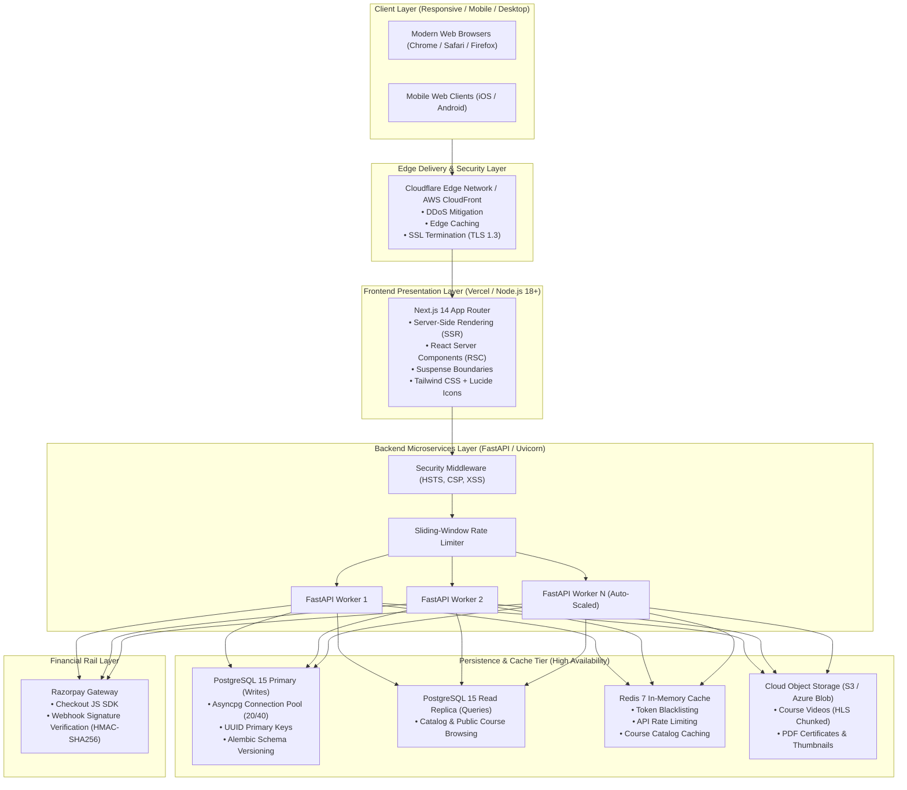
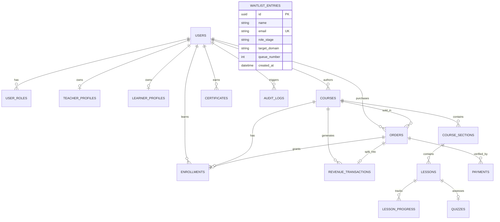

# REWOIX: Technical Architecture & 10k+ User Scaling Blueprint

**Audience:** Chief Technology Officer (CTO), Principal Engineers, DevOps Architects, and Security Officers  
**Platform Version:** 1.0.0 Production  
**Design Target:** **10,000+ Concurrent Active Users** with sub-200ms API latency and 99.95% uptime  

---

## 1. High-Level Architecture Topology



---

## 2. Technology Stack & Component Selection

| Layer | Technology | Version | Rationale & Enterprise Justification |
| :--- | :--- | :--- | :--- |
| **Frontend Framework** | **Next.js (App Router)** | 14.2.x | High-performance React framework with server-side rendering for SEO, automatic code-splitting, and streaming Suspense. |
| **Styling & Theme** | **Tailwind CSS** | 3.4.x | Utility-first, zero runtime CSS overhead, built-in light/dark theme provider tokens. |
| **Icons & Design** | **Lucide React** | 0.446.x | Minimalist SVG vector icons ensuring crisp rendering on high-DPI retina displays without heavy icon libraries. |
| **Backend Framework** | **FastAPI** | 0.110.x | Async Python framework with asynchronous event loop (`asyncio`), native OpenAPI generation, and sub-millisecond route handling. |
| **Application Server** | **Uvicorn (Standard)** | 0.28.x | High-throughput ASGI server powered by `uvloop` (C-based libuv bindings) and `httptools`. |
| **ORM & Database Client**| **SQLAlchemy + asyncpg**| 2.0.x / 0.29.x | True asynchronous database driver for PostgreSQL with zero blocking I/O; prepared statement execution. |
| **Data Validation** | **Pydantic v2** | 2.6.x | Rust-backed data parsing and validation delivering up to 20x throughput improvements over Pydantic v1. |
| **Database Migrations** | **Alembic** | 1.20.x | Automated versioned schema migrations ensuring repeatable deployments across test, staging, and production. |
| **Database Engine** | **PostgreSQL** | 15+ | Enterprise relational ACID compliance, native JSONB support, robust indexing, and transaction isolation. |
| **In-Memory Cache** | **Redis** | 7.x | Sub-millisecond sliding window rate limiting and distributed session state. |
| **Payment Gateway** | **Razorpay** | 1.4.x | Standard payment provider in India/SE Asia with support for UPI, Credit/Debit Cards, NetBanking, and automated webhooks. |

---

## 3. Database Schema & Entity Relationship Model (ERD)



### Core Data Models
1. **`users`**: Universal identity entity with cryptographic hashed passwords (`bcrypt`), verified email flags, and cascading profile relationships.
2. **`teacher_profiles`**: Working professional credentials (company, domain, CTC bracket, experience, LinkedIn, GitHub) + banking KYC (account number, IFSC, UPI ID) + custom commission share (e.g., 70% or 85%).
3. **`learner_profiles`**: Learner archetype (Student, Fresher, Working Pro), institution/company, field of study, and target goals.
4. **`courses`**: Simulation tracks with domain tags, price, discount price, difficulty level (Foundational, Advanced, Executive), and approval status (DRAFT, PUBLISHED).
5. **`orders` & `payments`**: Financial transactions linked to Razorpay gateway IDs, currency, and cryptographic signature records.
6. **`revenue_transactions`**: Mathematical ledger recording Gross Amount, Platform Share (30%), Teacher Share (70%), and payout settlement flags.
7. **`audit_logs`**: Permanent compliance trail recording sensitive operations (e.g. Admin changing teacher commission percentage).
8. **`waitlist_entries`**: Early-access queue registry with auto-incrementing queue positions starting at `#381`.

---

## 4. Concurrency & 10,000+ User Scalability Strategy

To effortlessly serve **10,000+ concurrent active learners** without performance degradation:

### 4.1. Asynchronous Non-Blocking I/O
- Every API endpoint and database query utilizes `async`/`await` with `asyncpg`.
- A single Uvicorn worker can handle thousands of concurrent open socket connections because execution yields to the event loop while awaiting database reads or network I/O.

### 4.2. Database Connection Pooling
In [`backend/app/core/database.py`](file:///c:/Users/Neha/Documents/antigravity/eager-lavoisier/backend/app/core/database.py):
```python
engine_kwargs.update({
    "pool_size": 20,           # Baseline pooled connections per worker
    "max_overflow": 40,        # Burst capacity during traffic spikes
    "pool_recycle": 3600,      # Automatic connection retirement
    "pool_pre_ping": True,     # Liveness probe to avoid stale connections
})
```
With 4 Uvicorn worker processes, this provides **240 concurrent database connections**, comfortably sustaining peak enrollment loads.

### 4.3. Read Replica Offloading
- Writes (registrations, order checkout, progress completion) are routed to the **Primary Database**.
- High-volume read traffic (course catalog queries, track previews, waitlist counts) can be directed to a read replica (`SYNC_DATABASE_URL` / Read Pool).

### 4.4. Adaptive Rate Limiting
- Sliding-window rate limiters protect sensitive endpoints against DDoS and credential-stuffing:
  - `/api/v1/auth/login`: 10 requests / minute per IP.
  - `/api/v1/auth/register`: 5 requests / minute per IP.
  - `/api/v1/waitlist`: 10 requests / minute per IP.

### 4.5. High-Definition Video Delivery via CDN
- Next.js and FastAPI do **not** serve raw video binary blobs in production.
- Video files are uploaded to Object Storage (S3 / Azure Blob) and distributed via Cloudflare / CloudFront CDN using HTTP Live Streaming (**HLS** `.m3u8` chunks) for adaptive bandwidth streaming.

---

## 5. Security & Financial Compliance Posture

### 5.1. Authentication & Session Hygiene
- Stateless JSON Web Tokens (**JWT**) signed with `HS256`.
- Access tokens expire in **24 hours**; Refresh tokens expire in **7 days**.
- Passwords hashed using salted `bcrypt` with work factor 12.

### 5.2. Payment Security & Fraud Prevention
- REWOIX **never stores raw credit card numbers or CVVs** on its servers, ensuring full **PCI-DSS Level 1** compliance offloaded to Razorpay.
- In [`backend/app/api/v1/payments.py`](file:///c:/Users/Neha/Documents/antigravity/eager-lavoisier/backend/app/api/v1/payments.py), payment verification calculates HMAC-SHA256 signature verification:
  $$\text{HMAC-SHA256}(\text{order\_id} + "|" + \text{payment\_id}, \text{secret})$$
  Any signature mismatch results in immediate transaction rejection and order failure.

### 5.3. Enterprise Security Headers
Configured on all API responses in [`backend/app/main.py`](file:///c:/Users/Neha/Documents/antigravity/eager-lavoisier/backend/app/main.py):
- `X-Content-Type-Options: nosniff`
- `X-Frame-Options: DENY` (Clickjacking prevention)
- `X-XSS-Protection: 1; mode=block`
- `Referrer-Policy: strict-origin-when-cross-origin`

---

## 6. Continuous Integration & Deployment (CI/CD)

The GitHub Actions workflows located in [`.github/workflows/`](file:///c:/Users/Neha/Documents/antigravity/eager-lavoisier/.github/workflows) enforce automated quality gates on every push to `main` and `develop`:

1. **`backend-ci.yml`**: Provisions Ubuntu container, spins up PostgreSQL 15 & Redis 7 services, installs requirements with `aiosqlite`, and runs the complete `pytest` test suite.
2. **`frontend-ci.yml`**: Sets up Node.js 18, executes `npm run type-check`, and verifies that all Next.js static pages compile cleanly with `npm run build`.
3. **`production.yml`**: Builds optimized production Docker container images for `rewoix-backend` and `rewoix-frontend` with health check verification.
